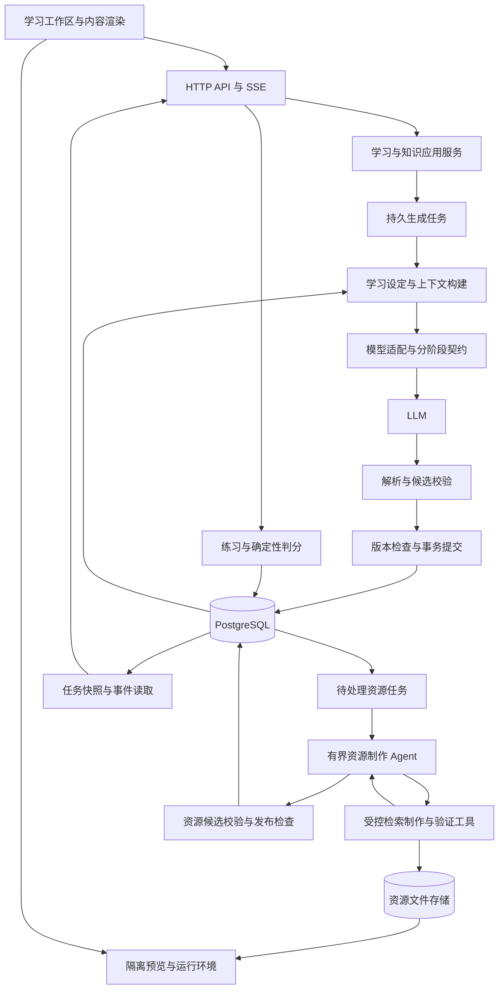
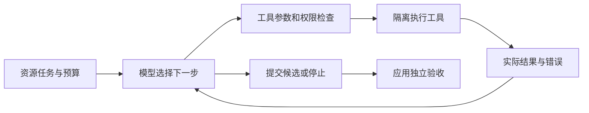

# Unfold：技术设计

状态：M0 已完成并验收，生成契约与 API 边界已有可校验实现；应用、数据库与持久任务尚未实现。更新日期：2026-10-07。产品约束以 [PRODUCT.md](PRODUCT.md) 为准；精确字段以 [契约实现与生成 schema](contracts/README.md) 为准，版本与运行基线见 [M0 决策](docs/decisions/0001-m0-baseline.md)。

## 架构原则

- LLM 负责用途问答、学习范围、知识组织、叶子判断、讲解与题目内容；程序负责权限、契约、状态、引用、预算、持久化与执行环境。
- 结构化输出是模型与应用之间的协议。会影响行为的信息必须使用独立字段，程序不从正文猜测是否为叶子、题型或答案。
- 各阶段使用独立输入输出契约，候选结果通过检查后才提交。结构合法、资源能运行、知识正确、用户掌握是不同结论。
- 正文采用内容块；非文本资源有独立生命周期。有效正文可以引用明确标为待制作的资源，不必等待所有媒体制作完成。
- 业务服务采用模块化单体；生成代码的执行与预览使用隔离环境，不在 API 进程中执行模型返回的程序。

## Agent 与后端工程建设主线

项目定位为具备工具调用、持久任务执行和质量评测能力的 AI 学习平台。以下三项已具备有限技术验收与真实证据；M7 正在补齐综合交付与产品要求，独立人审仍未知。

| 技术主线 | 产品中的真实问题 | 应积累的证据 |
| --- | --- | --- |
| 可恢复的生成任务引擎 | 长耗时生成、重试、取消、重启与并发修改 | 故障注入、旧执行者提交被拒绝、事件恢复、数据库最终状态 |
| 教学资源制作 Agent | 同一教学目的可以复用、绘制或编码，制作失败需要按实际反馈调整 | 工具调用轨迹、构建/运行反馈、修复案例、独立验收与成本 |
| 知识上下文管理 | 知识空间增长后，在有限输入预算下保持范围与关系一致 | 上下文策略对照、重复/遗漏样例、输入量与延迟、摘要失效实验 |

用途问答、大纲、节点与练习保持明确的应用流程；资源制作引入一个边界清楚的单 Agent，允许模型根据工具结果选择下一步。固定流程调用模型与工具，不自动等于实现了自主 Agent。架构区分参考 [Building effective agents](https://www.anthropic.com/engineering/building-effective-agents)。

实施任务、依赖、里程碑和交付材料统一在 [PLAN.md](PLAN.md) 维护。当前证据见 M3 持久任务、M5 资源 Agent 与 M6 上下文报告；简历指标必须关联实际实验，不以框架数量、模型自评或预估数据作为成果。

## 技术基线与后续组件候选

以先自己使用、兼顾 AI 应用后端能力为目标，锁定一个代码库、一套 Python/FastAPI 后端和一个 React/TypeScript/Vite 前端。初期采用模块化单体。M0 的契约工具已运行；下表未接入的渲染、网页与图交互组件仍是后续候选，具体版本和能力在相应里程碑实测锁定。

| 部分 | 建议 | 取舍与引入条件 |
| --- | --- | --- |
| 主后端 | Python + FastAPI | 生成服务、异步 I/O、结构化模型集中在同一语言；TypeScript 服务端仍是可选替代 |
| 数据契约 | Pydantic | API 和模型输出分别定义契约，共用必要的领域类型；校验结构不代表校验事实 |
| 主存储 | PostgreSQL | 保存学习设定、概念、大纲、内容/题目版本、任务与资源元数据；用事务维护提交一致性 |
| 文件存储 | 资源存储适配层 | 本地开发可使用受管目录，部署后可接对象存储；保存图片、演示源码与构建产物，通过资源 ID 访问 |
| 数据访问 | SQLAlchemy + Alembic | 清楚管理事务、会话和迁移；版本已在 M0 锁定，M1 验证集成 |
| 前端 | React + TypeScript + Vite | 先支持交互工作区；当前没有确定的公开内容索引或 SSR 需求 |
| 正文 | react-markdown + remark-gfm | 标准 Markdown、表格与受控组件；普通正文不开放任意 HTML/JavaScript |
| 公式 | remark-math + rehype-katex / KaTeX | 使用 LaTeX 数学语法，不要求浏览节点时编译完整 TeX 文档 |
| 图示 | Mermaid，必要时受控 SVG | 适合流程、时序和结构图；与知识导航图的布局组件分开 |
| 网页演示 | 隔离的 HTML/CSS/JavaScript 展示环境 | 支持动画与运行示例；编辑器可评估 Sandpack，工具包本身不代替隔离设计 |
| 图交互 | 按界面决定是否采用 React Flow | 需要图交互时使用；自动布局另选 Dagre 或 ELK，并验证展开后的视觉稳定性 |
| 进度传输 | SSE + 常规 HTTP | 创建、取消任务走 HTTP；进度订阅走 SSE，任务查询接口用于恢复状态 |
| 模型调用 | DeepSeek V4.1 Flash + HTTP Responses 薄适配层 | API 名 deepseek-flash；非思考模式。结构化候选仍完整本地校验；不假定供应商强制 schema。真实兼容记录随 M0 基线保存 |
| 编排 | 应用流程 + 有界资源 Agent | 业务主流程采用明确步骤；资源制作允许模型按工具反馈决策；是否使用 LangGraph 由检查点需求与实现成本决定 |
| 测试与运行 | pytest、Playwright、Docker Compose | pytest 已用于 M0；数据库、Playwright 与 Compose 在相应实现时接入 |
| 观测 | 结构化日志与基本指标起步 | 按 run_id 关联阶段、耗时、token 与失败；分布式追踪在需要时引入 |

Pydantic 可导出 JSON Schema；模型服务支持哪些 schema 特性仍需逐项验证。[Pydantic 模型文档](https://github.com/pydantic/pydantic/blob/main/docs/concepts/models.md)

FastAPI 已有 SSE 支持。[官方 SSE 文档](https://fastapi.tiangolo.com/tutorial/server-sent-events/) React Flow 的自动布局需要外部库。[布局文档](https://reactflow.dev/learn/layouting/layouting)

Python 与 TypeScript 都能实现当前流程。这里锁定 Python 是为了集中生成、校验、评测的实现；后续若更重视前后端单一语言，语言调整须另作决策并验证迁移。当前没有引入两套后端的需求。

Redis、pgvector、独立图数据库和消息队列不列为初期必需依赖。分别在缓存复用、语义召回、复杂图查询或任务调度出现明确瓶颈后评估，记录问题、测量和收益。基础幂等与事务不能依赖将来加入这些组件。

## 整体架构与模块责任



图中业务模块位于同一代码库，首版采用一个资源制作 Agent，不预先拆分微服务或引入多 Agent 协作。问答、展开、讲解、出题与资源制作是不同操作，共用任务基础设施。API 负责接单、查询和取消，长耗时操作在事务外执行；持久任务执行者可作为同一代码库的独立工作进程运行。隔离预览是执行边界，不意味着需要拆分整套业务服务。

- 学习设定模块保存问卷、原始答案、模型假设与设定版本，驱动初次大纲生成和后续目标更新。
- 知识模块负责概念身份、关系与范围，不处理 HTTP 或模型供应商参数。
- 大纲模块负责节点位置、父子结构、路径、修订，以及当前设定下的展开判定。
- 内容模块负责节点概述、路径相关讲解、内容块、修订与用户纠错。
- 练习模块负责出题请求、题目版本、答案、解析、答题记录和判分。出题调用生成模块，按已保存答案判分不再调用模型。
- 资源模块负责资源请求、工具注册、Agent 执行、检索/生成、校验、构建、版本和文件存储；Agent 提交候选，就绪状态由程序维护。
- 生成模块负责任务生命周期、上下文、阶段契约、模型调用、受限修复与候选变更。
- 持久化模块提供事务边界；模型返回结果不能直接绕过规则修改正式知识。
- 前端按类型渲染内容，展示服务端允许的操作；可运行内容只能进入被支持的隔离运行环境。

## 最小领域模型

以下是职责划分，不是已经确定的 SQL 表或完整字段清单。

| 概念 | 负责的事实 |
| --- | --- |
| KnowledgeSpace | 某次探索的主题、当前学习设定与大纲修订、访问归属 |
| IntakeSession | 用途问卷、问题/选项稳定 ID、原始答案、追问与完成状态 |
| LearningProfileRevision | 不可变的学习设定版本：用途、基础、目标能力、范围、排除项、约束及每项来源 |
| Concept | 知识空间内的稳定概念身份、名称、别名和语义范围 |
| OutlineItem | 大纲中的一次出现、父项、顺序与节点类型；概念节点关联 Concept，教学分组可无 Concept |
| ExpansionDecision | 某节点在指定学习设定和内容修订下的可展开/叶子判定、理由与适用范围 |
| Relation | 两个概念间有类型的联系、说明与适用范围 |
| ContentRevision | 节点概述、讲解内容块、依赖的学习设定/路径修订与生成来源 |
| ExerciseRevision / ExerciseAttempt | 题目、答案与解析的不可变版本；用户选择、判分规则和结果另行记录 |
| ResourceRequest / ResourceRevision | 教学目的、制作要求、生命周期；实际文件、来源、摘要、运行配置与验证记录 |
| GenerationRun | 各类生成或资源制作请求、输入快照、幂等键、状态、attempt 与执行记录 |
| ToolInvocation | 某次资源任务中的 step、工具版本、输入/输出引用、执行状态、耗时与错误；未知外部结果需单独标记 |
| GenerationProposal | 模型提出的候选节点、边、内容或结构修改，尚未代表正式知识 |

第一版以单个 KnowledgeSpace 为复用范围。同义词与同一概念的不同出现可以复用；仅有标题相同或向量相似不足以自动合并。跨知识空间共享以后再设计。

大纲父子关系要求无环。一般知识关系允许有环；严格前置依赖需要单独定义、检查。不能对全部关系统一施加 DAG 约束。

概念相同不强制讲解、练习或子树相同。叶子判定不放在全局 Concept 上；路径移动、内容更新或学习目标变化后检查判定是否过期。已保存的结构和用户修改不因模型重规划而直接消失。

内容记录适用范围、生成时间、模型、提示模板版本和相关大纲修订，以便调查错误和重放实验。这些是生成来源记录，不等于事实引用或正确性证明。

## 分阶段结构化协议

API 请求、模型输出和数据库记录分别定义契约，共用稳定领域类型，但不让模型写入服务端权威字段。契约需要版本号；供应商结构化输出能力只作为第一层约束，服务端仍完整校验。

| 阶段输出 | 主要字段与检查 |
| --- | --- |
| QuestionnaireProposal | 问题/选项局部 ID、单选/多选类型、自由补充与未知选项；检查唯一性、选项引用、题数与轮次上限 |
| LearningProfileProposal | 学习用途、基础、目标能力、范围、排除项和假设；与原始答案关联，不能把推断伪装成用户确认 |
| OutlineProposal | 根节点及概述、组织依据、第一层子项、关系和各节点判定；只含允许的一层，窄主题根节点也可直接为叶子 |
| NodeExpansionProposal | 目标位置、对当前节点的判定、下一层节点及概述；引用必须匹配本次请求，叶子结果不得带新增子项 |
| ExplanationProposal | 当前节点的补充讲解、例子和内容块；不借此操作偷偷增删大纲 |
| ExerciseSetProposal | 考查点、关联内容、题型、选项、正确选项集合、解析；检查单选唯一答案、答案引用及允许题型 |
| ResourceRequest / ArtifactCandidate | 教学目的、资源类型、制作要求、可选运行环境或候选文件；模型不能自行宣称资源已获取、已运行或已验证 |

以上名称为逻辑类型，不要求一次模型调用输出所有类型。问卷与练习可以复用前端选项组件，但前者是需求收集、无正确答案，二者的数据契约与存储职责分开。

模型请求由程序附上 operation、schema_version、run_id/attempt、目标位置、profile_revision、base_revision 和能力清单。模型只返回该操作允许的候选内容。正式实体 ID、权限、成功状态、文件地址和用量来自服务端或实际工具返回；候选局部 ID 经检查后解析为正式引用。

验证按顺序执行：

1. 解析和 schema：类型、必填字段、长度/数量预算、支持的枚举；拒绝将正文当控制字段。
2. 确定性业务检查：引用、答案选项、树循环、节点归属、单层边界、资源能力和叶子/子项矛盾。
3. 语义质量检查：用途一致性、重复、覆盖、讲解与题目对齐、事实疑点；可采用规则提示、模型复核和人工样例，结果仍是判断而非正确性证明。
4. 提交资格检查：任务当前 attempt、取消状态、学习设定和内容基础版本仍有效，才允许提交。

解析失败、供应商拒答、截断和不支持 schema 等作为明确错误处理。可以带验证错误进行有限次数修复，次数和费用计入原运行；不得无限自动重试、降级为自由文本解析或错误地标记成叶子。

## 学习设定、叶子与练习规则

### 学习设定

保留原始答案、整理结果与来源标记。后续生成必须读取持久设定，不依赖聊天上下文偶然保留。目标、当前能力证据和模型假设分别存储；难度/深度/广度先以可解释语义表达，不引入未经校准的精确等级。

设定修改产生新版本。新任务使用当前版本，旧运行提交时检查版本并转冲突，不能把旧目标下的内容静默发布到新目标。旧内容仍可阅读；用于新设定的展开判定过期时，先重新评估，未评估不默认开放展开。

### 展开判定

- 模型有效决定为 expandable 或 leaf；pending/stale 等表示程序尚无适用判定，不是模型的知识结论。
- leaf 必须有理由，禁止普通展开，服务端与前端一致执行；没有子节点不自动等于 leaf。
- 展开请求允许模型重新判断当前节点并返回 leaf + 空子项，避免为满足请求强行细分。
- 对本次目标节点的成功展开若返回 expandable，须提供有意义的下一层；新子节点只附概述与自身判定，不提前生成孙节点。截断、空结果或资源限制进入错误/暂停处理，不悄悄改写成叶子。
- 修改目标或用户反馈可发起独立重新评估。普通重试、补充讲解、答题或重新生成不能绕过仍有效的叶子限制。
- 若新判定与已有子树冲突，需要显式结构修订：保留旧版本并明确当前子树的归属/可见性，不直接删孩子或保留相互矛盾的活动状态。首版可先记录待处理重组建议。

任务状态、节点判定、已有展开结果、内容缺口和练习表现分别记录。最大层数或预算限制是应用的执行约束，不是 leaf 的生成依据。

### 练习

题目关联所考查的节点与 ContentRevision，综合题可以引用多个已提供的内容。题目、答案和解析版本一并冻结，题目修正产生新版本，不重写历史作答。题目被报告有问题时可停用并排除其对能力判断的影响。

首版锁定单选按选项 ID 相等、多选按集合完全相等判分，默认 3 题、单次 1～5 题，暂不支持部分得分。展示顺序可以变化，答案引用不能依赖 A/B/C 的显示位置。正确答案与解析由服务端保存，作答提交前不混在普通题目响应里。

反馈可以触发补充解释、前置建议或同考点新题，不自动变更学习目标或叶子判定。不凭少量答题产生“已掌握”结论；运行示例成功也不能作为通用编程题判分。

## 上下文与生成

一次展开输入包括：稳定的学习设定及其版本、领域整体概述、当前路径、当前节点概述与范围、已有子项、相邻分支职责、必要关联概念，以及相关反馈。出题另包含实际已提供的内容、考查点和允许题型；资源生成另包含教学目的、实际数据/公式和能力清单。

上下文选择按以下职责实现：

1. 固定保留当前学习设定、任务要求、路径、节点范围和明确限制，单独预留输出预算。
2. 读取父层、已有子项和相邻分支职责，保证展开具备局部结构依据。
3. 在当前知识空间检索相关概念与资源。先使用结构关系、别名和关键词，按预算选择候选；向量检索与重排在对照实验显示收益后再引入。
4. 较远的正文按需使用摘要，记录摘要所依赖的内容/结构修订；依赖变化后失效或重建。无法容纳必需信息时明确报告限制，不静默丢掉学习目标。
5. 记录本次实际选择与排除的内容、选择依据、依赖版本、估计输入量和实际用量，便于重放和定位不一致。

正式内容、用户设定和模型摘要有不同来源，检索到已生成内容不代表它已经成为事实依据。概念复用仍须检查范围；同名或向量相近不能直接触发合并。

保留三种可比较策略：尽量包含全部历史、只包含当前路径、按结构和相关性选择。在相同任务、模型和明确预算下比较质量与成本；全部历史超过模型限制时记录不可执行情况或事先定义的截断规则。记录重复、遗漏、关系错误、输入 token、延迟和费用，不预设新策略一定更好。样例划分与指标口径见 PLAN.md。

生成只提出变更。程序检查 schema、引用是否存在、关系类型、范围、重复候选与相应子图的循环。模型辅助的语义检查仍可能出错，不将通过检查标为“事实已证实”。

用户答案和检索资源描述作为有来源的数据进入上下文；应用规则、输出契约、用户设定和参考材料分层组装。权限、可执行动作和数据写入由服务端约束，提示词标签不被当作独立的安全保证。

## 内容协议与渲染

ContentRevision 使用有顺序的 blocks。正文内部保留 Markdown，交互和资源使用可判别的独立类型，避免把任意脚本嵌入正文或靠解析 Markdown 代码围栏决定执行。

| block 类型 | 内容与渲染责任 |
| --- | --- |
| markdown | 标准 Markdown、GFM、LaTeX 数学语法与静态代码高亮；静态代码默认不可执行 |
| diagram | 受支持的 Mermaid 描述或受管 SVG 资源，包含说明和文字替代 |
| image | 正式资源引用、alt、图注；来源、许可与生成记录从资源元数据读取 |
| playground | 代码资源引用、允许的运行环境与展示配置；编辑、运行、输出、停止/重置 |
| interactive | 演示组件及参数，或独立网页资源引用；播放、暂停、单步、参数调整等按需提供 |
| exercise | 题目或题组引用；使用独立答题组件，不从正文提取答案 |

候选内容可以先使用局部 resource_key，服务端提交时绑定为真实的资源请求引用。以下仅示意一次内容候选中的资源声明，不是完整 API 定义：

```json
{
  "schema_version": "content.v1",
  "overview": "观察二分查找如何逐步缩小查找范围。",
  "blocks": [
    { "type": "markdown", "text": "在有序数组上比较中间元素，并保留可能包含目标的区间。" },
    {
      "type": "interactive",
      "resource_key": "binary-search-demo",
      "fallback_text": "每一步比较中间元素，命中则结束，否则缩小候选区间。"
    }
  ],
  "resource_requests": [
    {
      "key": "binary-search-demo",
      "kind": "interactive",
      "purpose": "演示查找区间如何变化，并处理命中和未命中的结果。",
      "runtime": "web",
      "controls": ["play", "pause", "step", "reset"]
    }
  ]
}
```

运行环境、组件、依赖和资源类型来自程序能力清单。遇到不支持的类型时明确返回能力限制，保留文字或静态替代，不把未知内容当 HTML 执行，也不假装已有资源。

正文渲染推荐 react-markdown + remark-gfm + remark-math + rehype-katex。禁用正文任意 HTML 执行，检查链接和资源协议；KaTeX 保持不信任输入的设置并限制宏展开和尺寸。图示使用 Mermaid 的严格配置；模型提供的 SVG 经过清理或作为不执行脚本的图像展示。渲染失败在对应块显示错误与文字替代，不拖垮整个节点。

不把模型生成的 MDX 直接编译执行在主应用里；MDX 的 evaluate 会执行 JavaScript。需要交互时走显式资源协议与隔离运行环境。完整 LaTeX 文档编译留作未来讲义导出，不是浏览知识节点的必需路径。

依据：[react-markdown 数学公式示例](https://github.com/remarkjs/react-markdown#use-remark-and-rehype-plugins-math)、[KaTeX 安全选项](https://katex.org/docs/security)、[Mermaid 安全级别](https://mermaid.js.org/config/schema-docs/config-properties-securitylevel.html)、[MDX 执行接口](https://mdxjs.com/packages/mdx/)。

## 资源获取、制作与持久化

### 来源选择

| 资源目的 | 首选获取方式 | 必须区分的事实 |
| --- | --- | --- |
| 真实照片、显微图像、实物 | 有来源的图片检索工具 | 实际取回的图像、原始来源与说明；不能用生成图替代真实观察 |
| 流程、几何、结构关系 | Mermaid、受控 SVG 或绘图组件 | 布局能渲染不等于关系、标注和比例正确 |
| 数据图表、函数曲线 | 明确数据或公式驱动的绘制 | 原始数据来源、单位与模拟数据标记；模型编造的数据不能作为实测结果 |
| 情境插画与视觉比喻 | 可选的图像生成供应商 | 生成来源与用途；科学细节仍需检查 |
| 交互过程与算法动画 | 已有组件参数化，必要时制作独立网页 | 教学模型、输入范围、简化假设、行为与正文是否一致 |

LLM 输出检索需求或制作描述，实际工具负责返回候选文件与来源。模型可以从工具返回的候选中选择，不能编造资源 URL。外部文件获取只接受允许的协议和来源，限制体积、类型和重定向并防止访问内部地址；服务端权限不由检索结果或模型文字决定。

首版接入一个有明确来源的图片通道，具体供应商待定。文件级记录原始页面、作者、许可及所需署名；能搜索到不等于有权复制到产品。参考 [Wikimedia Commons 资源复用说明](https://commons.wikimedia.org/wiki/Commons:Reusing_content_outside_Wikimedia/en)。

### 生命周期

1. 内容候选通过检查后，在同一事务中保存正文、资源请求和持久待执行任务。待制作引用本身是有效状态，但不可宣称文件已经存在。
2. 资源执行者读取待处理任务，进行检索、绘制或生成；耗时操作与数据库事务分离。
3. 根据资源类型检查文件解码、尺寸、图示语法、构建和基本交互；执行生成代码必须进入隔离环境。
4. 先写入不可变资源文件并校验摘要，再用事务保存资源版本、实际验证记录、任务状态和事件。文件存储与数据库不能假设共享一个事务；未成功引用的文件可后续清理。
5. 发布前再次检查当前 attempt、取消状态和目标内容版本；过期任务不能覆盖已换版的内容。旧资源按版本保留或进入待清理状态。
6. 前端订阅状态更新并替换占位内容；失败保留说明和重试入口。重试只处理该资源，不重复生成整个节点。

ResourceRequest 的状态建议为 pending、running、ready、failed、cancelled。不可变 ResourceRevision 保存类型、内容摘要、文件引用、依赖、来源、生成模型与提示版本、运行配置及验证记录；ready 表示通过该资源类型规定的技术检查，不等于科学正确。

图片等文件在受管目录或对象存储中，数据库保存元数据和引用，不把大体积 base64 放进生成响应和事件流。自有托管以满足来源使用条件为前提；外部嵌入也要保留来源与失效回退。前端获得受控的读取地址，正式内容依赖资源 ID，不依赖会过期的临时 URL。

昂贵资源按需制作并计入预算。修改正文导致资源失配时产生新修订和制作请求，不静默替换已保存版本。普通浏览直接读取已有资源。

资源请求成功后固定关联具体 ResourceRevision。主动重生成创建新请求与新修订，历史内容不通过 latest 指针自动追随新产物；用户看到的正文、图像与演示因此可以按版本重现。

## 可运行代码与交互演示

### 首版网页环境

先支持限定能力的 HTML/CSS/JavaScript 示例。优先提供可复用的图表、时间轴和分步演示组件；需要定制时，资源包含入口文件、源码、固定依赖、输入/控制项、运行配置、文字替代和基本验证记录。

编辑器、预览与运行引擎分开。Sandpack 可作为编辑/预览候选，但依赖安装、外部资源加载、部署和隔离能力需要实测后决定，不能因为工具名包含 sandbox 就认为边界已经完备。[Sandpack 文档](https://sandpack.codesandbox.io/docs/getting-started)

- 生成代码不能在业务 API 进程或主应用 JavaScript 上下文中执行。构建时可能执行的依赖脚本同样受隔离约束。
- 网页预览使用独立来源和受限 sandbox iframe，限制导航、弹窗、下载和消息协议；不授予访问主应用 DOM、Cookie、令牌、模型密钥或数据库的能力。
- 网络策略独立于 iframe sandbox 配置，默认仅允许运行所需的受控资源；动态包名/版本和外部调用不能由模型无限扩展。
- 非 DOM 计算可在 Worker 执行，提供终止与重置；限制输入规模、输出量、执行时间和同时运行数量。iframe 不提供可靠的 CPU/内存硬配额，需要硬隔离的任务进入未来的受限执行服务。
- 基本验证包含加载、控制按钮、典型与边界输入、重置行为、控制台错误。实际执行记录与模型预测输出分别保存；技术通过不替代教学内容检查。
- 用户在示例中编辑的是工作副本，重置恢复已保存版本，不直接修改正式知识资源。
- 动画提供必要的暂停、速度/单步和文字替代，并考虑减少动态效果偏好；不要求依赖动画才能读懂所有内容。

隔离依据：[MDN iframe](https://developer.mozilla.org/en-US/docs/Web/HTML/Reference/Elements/iframe)。具体执行限制需在首版支持的浏览器上验证，不预先承诺任意生成程序都可安全、稳定运行。

### 后续运行环境

- Python 可评估 Pyodide + Web Worker，先定义包白名单、输入输出和计算上限；浏览器环境不等同完整 Python 主机。[Worker 使用](https://pyodide.org/en/stable/usage/webworker.html)、[兼容性限制](https://pyodide.org/en/stable/usage/wasm-constraints.html)
- 需要数据库、操作系统或完整后端服务的示例，后续使用独立受限执行服务；不复用业务数据库、宿主文件或供应商密钥。
- 自动编程判题需要题目测试、隔离执行、判分规则和结果记录，作为独立能力设计。示例可运行不意味着已实现在线评测系统。
- 视频生成、完整讲义导出和更多模拟引擎按实际学习需求增加，沿用资源版本与引用协议。

## 教学资源制作 Agent

### 任务边界与工具

每次 Agent 只处理一个已登记的资源请求。输入为学习设定、关联内容版本、教学目的、支持的运行环境、可用工具及预算；输出为资源候选、已有资源复用建议，或带原因的未完成结果。它不能修改用户目标、改变叶子判定、扩展知识树或直接发布正式资源。

| 工具职责 | 结果与约束 |
| --- | --- |
| 查询已有资源/组件 | 返回资源 ID、用途、版本和可复用条件；按当前知识空间与权限过滤 |
| 检索图像与来源 | 返回实际候选、原始页面和许可信息；受网络策略与预算限制 |
| 读取关联内容 | 返回当前任务授权的节点内容和依赖，不开放任意数据库查询 |
| 创建或修改候选文件 | 在该任务隔离工作区写入源码/图示，记录文件修订，不写主应用或宿主任意路径 |
| 构建与预览检查 | 在隔离环境返回实际构建错误、日志、控制项和边界行为检查结果 |
| 提交候选 | 返回候选引用供应用校验；不授予成功状态、权限或正式发布能力 |

工具接口包含参数契约、返回结构、错误分类与幂等语义。内部注册接口即可起步；是否通过 MCP 暴露由复用场景决定，不为协议名称额外引入服务。

### 按反馈决策的循环

Agent 可以选择复用组件、检索资料、编写文件、读取错误后修复、改变实现方式或终止。运行时验证工具请求并执行，把实际结果返回给模型；不能由固定顺序假装模型已经自主选择，也不能将模型预测的输出当作执行记录。



例如二分查找演示：模型先检查已有组件，必要时制作网页，读取构建或交互错误后修复，最终提交可播放/单步/重置的候选。程序检查典型与边界输入、运行行为和发布资格，人工样例检查教学内容。Agent 不能修改其最终验收标准来获得通过。

### 执行控制与恢复

- 程序限制 step、工具调用、修复次数、墙钟时间、费用和并发，达到上限返回明确未完成状态。
- 参数错误、工具业务错误、暂时性外部故障和结果未知分别处理；可重试范围由程序定义，避免重复无变化调用。
- 保存每步工具输入/结果、文件修订和预算消耗。恢复只从已完成、可确认的边界继续；外部结果未知时先核对或按工具幂等策略处理，不盲目重放副作用。
- 即使使用编排框架，其检查点也不能代替数据库事务、任务资格检查和外部副作用管理。
- 最终技术检查由程序强制执行；是否科学正确、是否适合教学另行评估。演示加载成功不能作为所有维度的成功。

先保留单次生成和固定修复流程作为基线，再与有工具决策的 Agent 比较任务成功、工具调用、修复次数、耗时和每个成功任务成本。失败、超时、预算退出都必须保留。

## 任务可靠性与提交

建议将用户发起的操作与进度连接分开：先创建任务得到 run_id，再订阅事件。断开 SSE 不等于取消任务，取消是独立操作。原生 EventSource 使用 GET；采用 POST 流时需要客户端自行读取流。[FastAPI SSE 文档](https://fastapi.tiangolo.com/tutorial/server-sent-events/)

| 问题 | 第一版建议约定 |
| --- | --- |
| 重复点击或网络重试 | 用幂等键和请求参数摘要识别同一请求；同键不同参数拒绝，重生成使用新键 |
| 同一位置重复展开 | 对相同位置、操作和基础修订复用活动任务或返回冲突；与主动重生成区分 |
| 并发修改 | 生成前记录基础修订；提交时进行版本检查，过期结果转为冲突，不能覆盖新内容 |
| 部分生成结果 | 未闭合的 JSON 或未验证的候选只可作为临时预览；通过校验并提交后才成为正式内容；合法的待制作资源引用不要求媒体同时完成 |
| 事务边界 | 模型调用在数据库事务之外；该操作的正式变更、修订、待执行资源任务、成功状态和完成事件在一个事务提交 |
| 服务重启 | 中断运行在恢复时被识别并进入可重试状态；首版可整次重试，不承诺从任意 token 续跑 |
| 取消与超时 | 尽力取消外部调用；提交时再检查任务资格，已取消的尝试不能发布结果；取消资源制作不回滚已经提交的正文 |
| 断线重连 | 用事件序号恢复仍保留的事件；事件过期时取任务快照和最新大纲，不重新触发生成 |

建议状态为 queued、running、succeeded、failed、cancelled、conflicted，运行阶段单独记录。计划使用数据库中的持久任务记录、原子领取、执行租约和 attempt 标识；执行者续租，过期任务按策略恢复。重试增加 attempt 版本，只有持有当前执行资格的 attempt 可提交，旧执行者返回不能覆盖重试结果。领取和提交需要数据库条件更新/事务保证，不能依赖先查后写或进程内锁。

恢复能力分层实现：普通内容生成首版可整次重试；资源 Agent 可以从确认完成的工具边界恢复。供应商调用是否已经执行但未返回，需要记录未知结果与潜在费用。并发上限、队列容量和预算拒绝分别表达，避免把异步实现等同于无限并发。

不承诺模型调用只发生一次。供应商超时或进程崩溃可能造成重复调用与费用；保证的重点是数据库中的同一结果不会重复发布。待执行资源任务从数据库恢复，不依赖提交后一次性的内存通知；事件序号用于订阅恢复。具体领取条件、续租时机和恢复扫描间隔在对应实施任务中锁定并通过故障实验验证。

PostgreSQL 唯一约束支持请求身份等确定性去重，无法代替语义去重。[约束文档](https://www.postgresql.org/docs/18/ddl-constraints.html) 当前实现使用每事务独立的同步 Session，worker 线程不共享会话；若改为异步，每个并发任务也必须使用各自的 AsyncSession。[会话文档](https://docs.sqlalchemy.org/en/20/orm/session_basics.html)

实现资源 Agent 的工具边界检查点时，可评估 LangGraph 与直接维护执行记录的取舍；选择框架不改变业务事务与外部副作用的责任。[持久化文档](https://docs.langchain.com/oss/python/langgraph/persistence)

## 端到端操作示例

### 从领域到大纲

输入领域 → 创建问卷任务 → 保存并展示有效问卷 → 提交原始答案 → 生成并保存学习设定版本 → 自动创建初始大纲任务 → 校验根节点、第一层和概述 → 提交并展示。

界面可以直接修改学习设定；未知信息以假设标记，问卷题数与轮次有上限。每一步的持久记录使断线后可以恢复，不需要从头重新问答。

### 展开一个节点

读取当前设定与适用判定 → 服务端检查叶子限制与请求身份 → 获取幂等任务 → 组装路径、父层、已有子项和相邻范围 → 模型返回结构化候选 → 校验 → 检查版本/attempt/取消 → 事务提交 → SSE 通知前端。

已经展开的节点默认读取保存结果；重生成使用独立操作。LLM 可以在此次判断中终止展开；只有正式 leaf 结果提交后，前端关闭该位置的展开操作。

### 节点内资源与练习

正文提交并登记资源任务 → 资源制作和验证独立完成 → 更新资源占位块。用户请求练习时，基于已经提供的内容生成题目版本；用户提交选项后，由程序判分并返回解析。生成资源、生成题目、提交答案各自可重试和恢复，不把整个节点重新生成一遍。

## 单用户到多人使用

先支持一个本地或私有访问的使用者。知识空间和访问身份在服务边界明确，后续可以加账户与所有权；不因为只有一个用户就把状态放进不可区分的全局变量。

公开服务前另行完成身份认证、对象级授权、用户间数据隔离、调用配额、成本限制和部署配置。仅预留 owner 字段不代表已经具备多用户隔离。

## 评测、观测与验证

详细阶段和任务以 [PLAN.md](PLAN.md) 为唯一实施计划。评测从协议实验开始建立基线，随学习流程、持久任务、资源 Agent 和上下文策略逐步扩大。

验证至少覆盖：

- 生成质量：相同领域不同用途产生实质差异；内容逐层增加理解深度；检查事实、关系、分类维度、遗漏、重复、过早停止和无意义细分。
- 契约：各阶段成功样例、缺字段/错类型、截断、拒答、未知类型、错误引用、非法答案和叶子带子项；失败不能落入成功或可展开状态。
- 学习设定：原始答案与假设可区分，每次调用携带正确版本；设定变更时旧任务冲突，旧内容仍可读，过期叶子判定可重新评估。
- 练习：单选/多选判分可重放，选项顺序不改变答案，内容换版不改历史分数；人工检查歧义、多解、错误解析和超出已讲范围的题目。
- 渲染与资源：公式/图示错误局部回退，图片来源和许可可追溯；资源生成失败、重复制作、文件已写而数据库提交失败、取消与旧版本竞争不会污染正式内容。
- 执行：示例能加载、暂停/停止/重置和处理边界输入；不访问主应用数据，网络策略和消息检查生效，超时/大输出有明确行为；按实际支持浏览器验证。
- 任务可靠性：重复点击、并发修改、断线、进程中断、取消、超时、重试和旧 attempt 提交；模型调用可重复收费的边界如实记录。

人工参考集是评测材料，不是产品生成所需的输入。按任务家族划分开发集和保留测试集，避免近似重复样例跨集合泄漏；在开发基线之后、保留集评测之前固定判定口径。允许多个合理大纲，不能把唯一措辞或固定层数当作正确答案。M0 保留开发场景记录，M6 已执行公开合成解释候选保留集对照；独立人工质量与事实准确率仍未知，见对应报告。

### 三类证据

- 确定性测试：使用可控模型/工具替身和真实数据库检查契约、事务、并发、恢复和取消，重复执行并比较最终状态。
- 真实模型评测：固定任务、模型配置、提示版本、工具能力和预算，记录实际输出并重复运行。按预先约定的规则评分，保留失败与预算退出。
- 人工检查：检查用途适配、叶子是否合理、题目歧义、事实关系和演示教学含义；模型评分辅助筛查并与人工校准，不作为唯一事实依据。

每个实验同时保存最终产物和执行轨迹，不能仅因 Agent 宣称完成而计为成功。资源 Agent 比较单次生成、固定修复流程与工具反馈决策；上下文比较全历史、当前路径与选择性上下文。记录同模型/预算条件，质量、延迟与成本同时报告；不强迫新方案一定胜出。

### 观测与统计口径

通过 run_id、attempt、step、profile_revision、content_revision 和资源版本关联请求、工具调用与提交。记录实际工具输入/输出引用、耗时、错误类型、上下文选择和用量；可解释决策理由不等同于保存或依赖模型内部推理。日志与公开样例去除密钥、令牌和用户敏感内容。

分别报告首次结构合法率、有限修复后的合法率、实际任务成功率、重复发布/过期提交次数、恢复耗时、输入输出 token、工具次数、延迟分位数与费用。说明分母、样本量、失败/取消的处理及用量未知项。模型输出合法不能代替产品任务成功。

使用模拟调用的压力测试说明数据库、API 和队列能力；真实模型测试说明端到端延迟和费用，两者结果分别报告。没有真实用户数据时如实标为合成负载，不写成实际业务规模。一次成功不代表稳定，性能优化在固定数据集与记录清楚的环境中前后对照。

评测方法参考：[Demystifying evals for AI agents](https://www.anthropic.com/engineering/demystifying-evals-for-ai-agents)。

性能分别记录问答、大纲、正文、练习与资源的首个可用结果时间、完整提交时间、输入输出 token、重试率和费用；供应商未返回用量时标记未知。普通浏览复用率与媒体制作成本分开观测，不提前承诺准确率、延迟或成本数字。

后端工程展示围绕真实问题：异步生命周期、事务与版本冲突、幂等、迁移、故障测试和用量观测。仅列出使用的中间件不作为完成证据。

## 待决定

- Python/FastAPI 与 React/TypeScript/Vite 已锁定；M1 验证前后端与数据库实际集成。
- 主界面形态与问答呈现方式，见 PRODUCT.md；节点采用主动展开，叶子禁止普通展开的流程已确定。
- 结构重组先预览；用户手工编辑的具体范围仍待实现时确定。
- 首个供应商为 DeepSeek，实际调用别名 deepseek-flash；用户已将累计预算提高到 10 元，见额度记录。交互等待目标从真实耗时校准。
- 生成 schema v1 已有可校验实现，单阶段最多修复一次；供应商强制 schema 能力以实际兼容记录为准。
- 问卷最多 5 题/2 轮、默认 3 题、完全集合判分已锁定；语义评测材料已建立，接受口径从开发基线确定并冻结。
- 首个图源为 Commons；图示 Mermaid 严格渲染，网页为独立 Chromium 画面桥接与有界资源工具循环。源码副本编辑等缺口继续 M7，执行边界见决策 0003。
- 首个运行位置为本机单用户，绑定回环地址；当前不创建部署资源。

契约、数据库迁移、应用服务、独立 worker 与受管资源已有可运行实现；当前只支持本地单用户，最终清洁安装/备份恢复与展示交付继续 M7，不提前声称公开部署完成。
