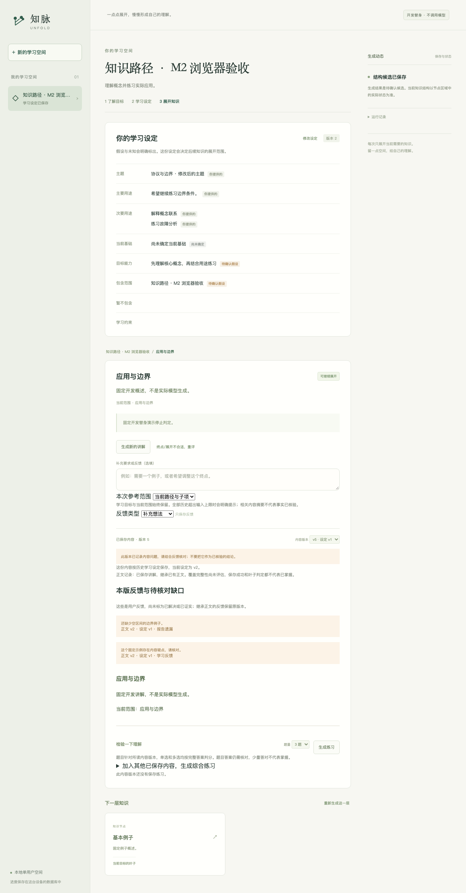

# Unfold / 知脉

[](https://github.com/danxiaogu520/Unfold/actions/workflows/ci.yml)
[](LICENSE)

一点点展开，慢慢形成自己的理解。

知脉是一个由 LLM 驱动的本地学习应用。输入感兴趣的领域，通过用途问答确定学习目标，再逐层展开知识大纲、阅读讲解并完成练习。支持开放领域，高中数学只是其中一个审阅样本。



*截图使用开发替身；学习目标、正文版本、反馈和生成任务均保存到本地数据库。*

## 可以做什么

- 从领域与用途生成学习设定，保留未知信息和假设，随后编辑目标。
- 逐层生成大纲和讲解，按目标判断叶子；目标变化后通过预览确认结构修订。
- 阅读 Markdown、公式与图示，练习单个知识点或最多五份已有正文；提交后查看答案与解析。
- 保存版本与反馈，查看生成任务、失败和恢复记录；关闭页面后任务仍可继续。
- 使用有界资源 Agent 制作交互演示，在独立 Chromium 中运行；图片保留来源与许可。

后端采用 FastAPI、PostgreSQL、持久任务与 SSE，前端采用 React、TypeScript 和 Vite。当前适用于**本地单用户**，服务绑定回环地址。知识准确性与学习效果尚未全面验证。

## 本地开始

固定工具链：Python 3.12.14、uv 0.12.23、Node.js 26.10.0、npm 12.1.0、PostgreSQL 18.6。准备 PostgreSQL 的可执行文件，将 `bin` 目录加入 PATH，或通过 `UNFOLD_PG_BIN` 指定。数据库脚本也会查找 Homebrew 的 `postgresql@18/bin`。

```sh
git clone https://github.com/danxiaogu520/Unfold.git
cd Unfold
uv sync --locked --extra app
npm ci --prefix web
npx --prefix web playwright install chromium
cp .env.app.example .env.app.local
chmod 600 .env.app.local
.venv/bin/python scripts/dev_database.py start
.venv/bin/unfold migrate
```

在项目目录打开三个终端，分别运行：

```sh
# 终端 1：API
.venv/bin/unfold serve

# 终端 2：生成任务执行器
.venv/bin/unfold worker

# 终端 3：网页
npm run dev --prefix web
```

打开 <http://127.0.0.1:5173>，输入领域，回答目标问答，然后从大纲选择知识点。必须同时运行 worker，生成任务才会执行。用 `Ctrl+C` 停止各终端，学习记录会保留；数据库可用 `.venv/bin/python scripts/dev_database.py stop` 关闭。

默认 `fake` 模式使用明确标记的固定开发替身，无模型费用。它用于体验流程和确定性测试，不会按任意领域生成真实教学内容。

### 使用真实 DeepSeek

复制 `.env.example` 为 `.env.local`，在本地填写 API 密钥、模型、价格与人民币费用上限 `UNFOLD_MAX_COST`，并执行 `chmod 600 .env.local`。示例价格是历史实验配置，运行前应自行核对供应商当前价格。不要将密钥提交到 GitHub。

将 API 和 worker 替换为以下启动命令：

```sh
UNFOLD_MODEL_MODE=deepseek .venv/bin/unfold serve
UNFOLD_MODEL_MODE=deepseek .venv/bin/unfold worker --model-env .env.local
```

真实模式会把本次任务所需的学习上下文发送给模型供应商并产生费用。费用在当前数据库的持久账本中预留和结算，重启不会清零；不同数据库副本不共享额度。详细配置、恢复与排查见 [开发说明](docs/development.md)。

## 验证与证据

普通 CI 使用 PostgreSQL 和固定替身，不读取模型密钥、不调用真实模型：

```sh
export UNFOLD_TEST_DATABASE_URL=postgresql+psycopg://unfold@127.0.0.1:54318/unfold
.venv/bin/python scripts/check.py --browser
```

首版已完成 M0～M7；本地验收包含 213 项 Python 测试（真实 PostgreSQL，0 跳过）和 10 项 Chromium 流程。真实模型实验保留成功、失败、用量和来源版本；高中数学六题有人工抽检记录，结论仅限该样本。公开证据中的本机路径已脱敏，清单哈希对应公开副本，见 [开源整理记录](docs/reports/open-source-publication-2026-10-07.md)。

| 入口 | 内容 |
| --- | --- |
| [产品定义](PRODUCT.md) / [技术设计](DESIGN.md) / [项目计划](PLAN.md) | 产品边界、架构与里程碑 |
| [本地开发](docs/development.md) | 工具链、启动、验证、备份与恢复 |
| [最终验收](docs/reports/final-acceptance-2026-10-07.md) | 工程证据、样本审阅与保留限制 |
| [评测说明](evals/README.md) / [契约](contracts/README.md) | 数据集、结构化协议与付费实验入口 |
| [架构讲解与回放](docs/interview.md) | 任务恢复、资源 Agent、上下文对照和录屏 |
| [贡献指南](CONTRIBUTING.md) / [安全说明](SECURITY.md) | 参与开发与问题反馈 |

## 许可证

原创源码、文档和示例采用 [MIT](LICENSE) 许可证。第三方资源保留各自许可，见 [THIRD_PARTY_NOTICES.md](THIRD_PARTY_NOTICES.md)。
