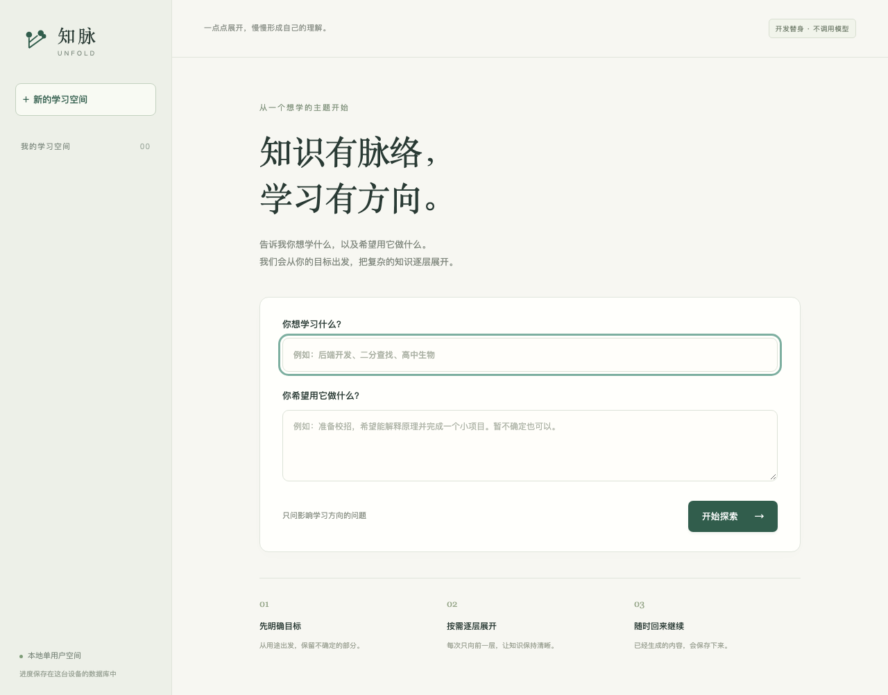
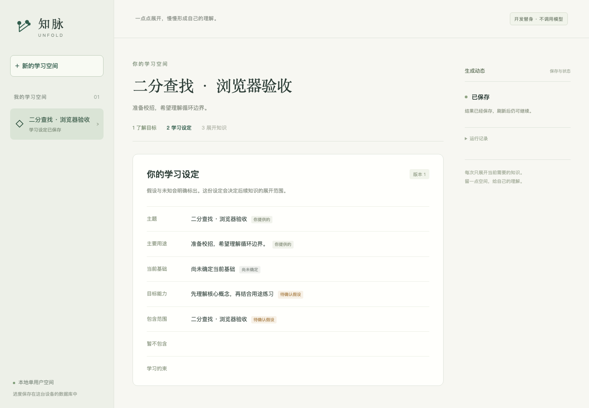

# M1 工程基础验收

日期：2026-10-07。结论：M1-01～M1-06 完成，本地工程、真实 PostgreSQL、任务最小路径与前端已经验证。M2～M7 继续推进。验收使用确定性开发替身，不计入真实模型质量基线。

## 实现与证据

| 要求 | 当前实现 | 直接证据 |
| --- | --- | --- |
| M1-01 工程和启动 | Git 仓库、Python/React 工程、精确锁文件、私密配置模板、服务/worker/迁移 CLI | [启动说明](../development.md)、`uv.lock`、`web/package-lock.json`、工具链清单；页面截图与实际 HTTP 流程 |
| M1-02 数据库 | PostgreSQL 18.6；14 张领域/执行表；冻结 Alembic 初始 SQL；空间内引用、版本、状态、唯一活动任务约束 | 空 schema 升级、回滚再升级、ORM/数据库无漂移、跨空间父引用与字段约束测试 |
| M1-03 模型适配 | DeepSeek Responses 与可控替身；统一错误；有限候选修复；缺失用量保持 null | M0 真实基线；现有适配器测试；新增持久调用/预算测试覆盖已知、未知、超时、截断 |
| M1-04 持久任务 | HTTP 创建/查询/取消；领取与 attempt；问卷/设定事务发布；事件重放；请求身份与活动复用别名保存 | 16 个并发键复用同一任务，结束后重发仍复用；队列跨空间限额；完成/失败轨迹 |
| M1-05 观测和敏感信息 | run/attempt/call、实际请求快照、供应商/提示/schema 版本、用量/费用/错误；安全数据库错误响应 | `/api/v1/runs/{id}/trace`；密钥脱敏、原始请求摘要保持差异、异常不回显测试 |
| M1-06 统一检查 | `scripts/check.py --browser`；GitHub workflow 固定 Action SHA 和 PostgreSQL 镜像摘要 | 全部 8 项本地检查成功；远程仓库尚未配置，远程 CI 未执行 |

代码入口为 `src/unfold/app/`，前端为 `web/`。同步 SQLAlchemy Session 分配到每个请求/worker/续租事务，模型网络调用在事务外；知识变更、任务终态和完成事件在同一事务内提交。跨空间队列/领取使用数据库事务 advisory lock；它不覆盖模型执行时间。

持久预算使用十进制费用、调用前预留、调用后已知用量结算。外部结果或用量未知时预留保留，重启与减小配置不重置已记录支出。M1 的支付配置沿用剩余授权，不增加真实付费调用。

## 本次验证

- Python 测试：**116 通过，0 跳过**，其中原有 M0 97 项、新增 M1 19 项。数据库测试使用真实 PostgreSQL，每项隔离 schema。
- 浏览器：**Chromium 2/2 通过**，实际 HTTP + PostgreSQL + 替身 worker；问卷→未知答案→学习设定→刷新读取，刷新没有额外 POST；移动端 390px 无横向溢出且空答案被拒绝。
- Ruff、格式、严格 mypy、30 份 schema 检查、锁文件检查、TypeScript/Vite 构建通过；M0 73 份历史证据、115 次调用与 98 份有效普通候选回放仍一致。
- 事务中断注入：完成事件已 flush、提交前抛错，内容与完成状态共同回滚；恢复提交后成功。取消后与过期 token 的提交被拒绝。
- 本轮真实模型新增调用 **0**，费用 **0 元**。此前高峰未命中价保守估算 0.8803 元，剩余授权保守上限 4.1197 元。

验收入口：

```sh
UNFOLD_TEST_DATABASE_URL=postgresql+psycopg://unfold@127.0.0.1:54318/unfold \
  .venv/bin/python scripts/check.py --browser
.venv/bin/python scripts/verify_foundation_evidence.py
```

固定证据位于 [`evals/evidence/m1-foundation`](../../evals/evidence/m1-foundation)。`success.json` 与 `failure.json` 保存实际 API 请求、最终快照、事件、attempt/call 轨迹和正式记录；替身明确标记为 `deterministic_fake`，失败没有正式问卷。`checks.json`、`python.xml` 保存验证结果，`manifest.json` 校验源快照与证据文件。截图已检查，桌面与移动端文字/控件可读、内容不溢出。





## 修复与限制

依赖和 PostgreSQL 下载出现过网络中断，已从官方源恢复并校验；本地数据库启动所需共享内存被沙箱拒绝，获准本地进程权限后初始化成功。PostgreSQL 构建移除了无效的 `--without-ssl` 参数。首次浏览器断言错误地用状态文本作为无名 status role 的 accessible name，改为检查角色文本后通过。

新增测试配置曾覆盖 M0 的共享 Settings fixture，首次全量运行出现 14 个 fixture 错误；恢复固定替身配置后，全部 116 项通过。旧失败没有作为成功结果计数。

当前 Starlette TestClient 仍兼容 HTTPX，但发出建议转向 HTTPX2 的弃用提示；真实服务继续使用已锁定的 HTTPX。CI 已配置而未在远程运行，不能将本地通过写成远程通过。

M1 只完成任务最小路径，不能声称全部恢复或所有故障被证明：租约恢复扫描、退避、事件保留期和完整竞争矩阵在 M3；大纲、节点内容、叶子重评与设定修改在 M2；练习和资源在 M4～M5。界面中的固定设定与题目没有教学质量结论。真实学习闭环、独立人工评分、知识事实核验与部署验收尚未完成。
