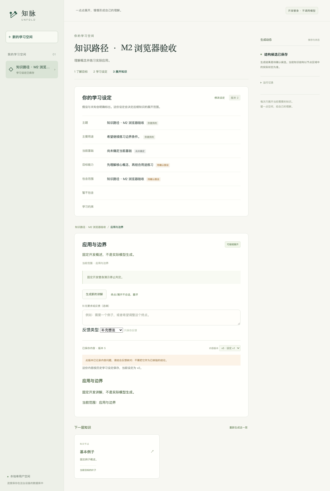

# M2 学习闭环验收

日期：2026-10-07。M2-01～M2-07 的本地应用闭环完成，继续 M3。验证覆盖真实模型的应用链路、确定性状态约束和有限内容复核，不把保存成功当作知识准确率或学习效果。

## 功能与证据

| 要求 | 实现与验证 |
| --- | --- |
| M2-01 用途问答 | 用途入口、已声明维度去重、单/多选、自由补充、未知；累计五题、两轮，分别保存原始问答。数据库/浏览器验证第三轮拒绝和历史答案不丢失。 |
| M2-02 版本化设定 | 来源标签、假设/未知、直接编辑、新版本和原始证据；目标改变使旧判定过期、执行中的旧任务转冲突。 |
| M2-03 根与第一层 | 只提交根与下一层、概述/范围/基础关系；局部 key 绑定服务器实体；真实窄场景直接根叶子。 |
| M2-04 展开与重评 | 叶子禁止普通展开、重生成和伪造快照的直接 API；独立重评；改已有结构先保存预览，显式采用后才归档旧树。 |
| M2-05 讲解与读取 | 路径导航、主动讲解、历史版本、问题反馈；读取不生成，讲解不改子树；概念规范身份与路径展示标题分离。 |
| M2-06 上下文 | 设定、路径、子项、兄弟范围、概念、反馈与正文来源；实际输入/选择材料/依赖版本留存。最小策略 v1 限材料 24,000 字节、输出预留 4,000 token，供应商请求另有字节与费用预留。 |
| M2-07 HTTP/SSE | 真实 HTTP/worker/数据库和 React；加载/失败/取消/重试；刷新恢复空间和路径，旧内容与结构候选分开显示。 |

**139 项 Python 测试通过，0 跳过；Chromium 4/4；统一入口 10 项检查通过。** 33 份 schema、类型、格式、前端构建及 M0/M1/M2 证据校验通过。远程 CI 已配置，尚无远程结果。

## 真实调用和失败

使用 M0 开发集 `backend-1`、`midpoint-1`，每批各一次，调用前固定选择。保留集未用于调提示。

| 批次 | 新真实调用 | 结果 | 保守费用（元） |
| --- | ---: | --- | ---: |
| m2-persistent-v1 | 8 | 窄链路成功；宽主题三个子概念误指父概念，范围不符，发布拒绝 | 0.067050 |
| m2-persistent-v2 | 9 | 两条链路 2/2 保存/读回；宽主题 10 节点，窄主题 1 根叶子，叶子 API 拒绝 | 0.098776 |
| m2-review-v1 | 2 | HTTP 修订例子字节数不正确，一次修复后未通过，没有新增正式讲解 | 0.068080 |
| m2-review-v2 | 4 | HTTP 修订先拒绝额外字段，保留完整候选后修复成功；用途候选被过强标题规则拒绝 | 0.090724 |
| m2-purpose-replay-v1 | 0 | 修正概念/路径标题规则后，重验保留的真实候选；只保存预览 | 0 |

合计 **23 次真实调用**，68,139 输入 token、23,544 输出 token，用量未知 0，保守费用 **0.324630 元**。加 M0 0.880300 元，本轮累计上界估算 **1.204930 元**，原 5 元授权剩余 **3.795070 元**。费用按高峰未命中价估算，M2 没有逐次账单，不称为实际扣费。

两条学习链路接受结果为 2/2。本次 20 个真实生成任务中 17 成功、3 失败；保留响应重放另列 1 个应用任务，不计作新推理或独立质量试验。所有历史失败留存。

复用要求声明的规范范围一致，较窄子概念不能静默绑定宽父概念。路径标题可以随用途变化，规范概念名称不被改写，同名本身不触发合并。原标题相等约束与“概念/路径分离”冲突，因此删除该多余限制，范围与归属检查保留。真实用途候选由原理模块转向接口实现、持久化、错误处理、测试与排查；只是定性观察，没有独立人工评分。

## 内容问题与修订

第二批 HTTP 讲解结构合法，却混同无长度字段的请求/响应边界、漏掉头字段合并例外，且未限定 HTTP/1.1。依据 [RFC 9112 §6.3](https://www.rfc-editor.org/rfc/rfc9112.html#section-6.3) 和 [RFC 9110 §5.2](https://www.rfc-editor.org/rfc/rfc9110.html#section-5.2)，核心问题已在修订版区分适用条件。

旧正文 v2 保留为 `reported`，修订 v3 仍是 `unverified`。复制旧正文会保留原设定来源与问题标记，不能称作按新目标生成。历史阅读不把反馈悄悄绑定到另一版本。

UTF-8 规则只检查展示的完整 HTTP/1.x JSON 例子，无体片段/其它格式不宣称被验证。明确错误报文可以保留，但必须给出正确字节诊断。该规则不验证全部网络知识；日期示意等细节仍需校对，全面事实核验与独立人工评分未知。

## 版本和复现

`profile-input.v2` 分别保存两轮，v1 单轮语义保留。`run.v2`/`event.v2` 用结果类型区分知识与结构预览，v1 定义用于历史读取。应用提示从 `app-prompt.v1` 演进到 v3，M0 `prompt.v3` 文件保留。批次各自保存实际源码和提示，后来修正规则不改写原试验判定。

```sh
UNFOLD_TEST_DATABASE_URL=postgresql+psycopg://unfold@127.0.0.1:54318/unfold \
  .venv/bin/python scripts/check.py --browser
.venv/bin/python scripts/verify_learning_evidence.py
```

证据位于 [`evals/evidence/m2-learning`](../../evals/evidence/m2-learning)：五批报告、请求/响应与失败、原始/修订正文、明确标记的保留响应重放、源快照、验证记录和截图。校验器不执行归档代码或重复付费。



M3 恢复、事件保留、退避与完整故障矩阵尚未验收。练习、来源图像、正式 Mermaid 渲染、隔离网页与资源 Agent 仍属 M4～M5；三策略对照属 M6。不声称学习效果、全领域知识正确或任意故障下严格一次调用。
