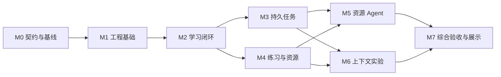

# Unfold / 知脉：项目实施计划

更新日期：2026-10-07。状态：**M0～M3 已完成并验收**，M4 技术验证完成，继续 M5～M7。本地学习问答、设定、大纲、单层展开、讲解、叶子、预览和保存可运行；持久任务恢复已验收；练习和来源图像已接入；网页 Agent、上下文与部署继续实施。生成质量与结构合法分开报告。详见 [M0 报告](docs/reports/m0-baseline-2026-10-07.md)、[M1 报告](docs/reports/m1-foundation-2026-10-07.md)、[M2 报告](docs/reports/m2-learning-2026-10-07.md)。

产品范围以 [PRODUCT.md](PRODUCT.md) 为准，技术协议与不变量以 [DESIGN.md](DESIGN.md) 为准。本文件只维护任务、顺序、工作量、验收和证据；设计变化先更新对应文档，再调整任务。

2026-10-07 后续授权：用户将本轮总额度提高到 **10 元人民币**。已记录保守费用 1.204930 元保留，当前剩余 8.795070 元，见 [额度记录](docs/decisions/0002-budget-authorization.md)。各阶段报告中的原预算数值保留为历史状态。

## 目标与完成层次

1. 自用体验：从领域输入，经用途问答得到学习设定，阅读并逐层展开知识，遇到叶子停止，完成相关练习，并复用已保存内容。
2. 首版产品：在基础体验上具备任务恢复、公式/图示/图片、一个隔离网页演示环境，以及能按工具反馈制作资源的单 Agent。
3. 面试展示：可演示持久任务一致性、资源 Agent 的真实行动循环和上下文策略对照；用可复现的实验、故障记录和代码支撑简历表述。

| 完成点 | 可交付状态 | 仍缺少的主要能力 |
| --- | --- | --- |
| M2 完成 | 可探索的早期预览：问答、设定、大纲、讲解、叶子与保存 | 完整恢复验证、练习、多媒体与 Agent |
| M4 完成（含 M3） | 带持久任务、练习和基础资源的自用预览 | 网页演示 Agent 与完整首版验收 |
| M5 完成（含 M0～M4） | 首版功能范围具备，可进行系统验收 | 上下文对照结论、最终部署演示与证据整理 |
| M7 完成（含 M6） | 在声明环境中通过验收的面试展示版本 | 多人公开服务、通用代码判题等后续范围 |

M5 功能具备不等于自动通过 M7 的发布/展示验收。编写了接口、生成了示例或模型声称完成，都不能代替对应验收。

## 规划假设与开工决策

- 按单人推进、Python/FastAPI 后端、React/TypeScript 前端、PostgreSQL 和受管资源存储估算；这些是当前推荐基线，M0 锁定。
- 首版面向本地或私有访问，先接一个模型供应商和一个有来源的图片通道。资源 Agent 只支持一个受控网页运行环境。
- 评测从 M0 建立，不等待功能全部结束。可靠性从 M1/M2 具备基本约束，在 M3 系统深化。
- 不要求先实现多 Agent、微服务、向量库、消息队列、图数据库、通用编程判题、微调或多用户商业服务。新增依赖必须对应已测到的问题。
- 首版已有任务中可做合理的实现选择；用户已指定 DeepSeek V4.1 Flash 和 M0 总预算 5 元，凭据仅在未入库本地配置。图源账户在接入前明确，不使用虚构配置代替可运行方案。
- 已进入实施阶段，M0 代码、依赖锁与评测材料已创建；数据库、应用及 CI 在 M1 建立，其他未来材料不视为已存在。

| 决策 | 最迟时间 | 未明确时的处理 |
| --- | --- | --- |
| 主语言、框架、仓库布局与版本 | M0 退出前 | 按推荐方案完成比较与记录，锁定后进入工程初始化 |
| 首个模型、凭据和实验费用上限 | M0 真实调用前 | 可先定义契约与样例，不把模拟结果当作真实模型基线 |
| 问答上限、默认练习量、内容操作语义 | M0 契约冻结前 | 采用小规模可配置建议值，记录为初始参数 |
| 图源、许可处理和文件存储方式 | M4 资源接入前 | 不编造图片，不以失效占位宣称图源完成 |
| 网页运行能力、工具集与预算 | M5 执行生成代码前 | 先使用已验证的受控组件；不能跳过隔离要求 |
| 展示位置、访问方式和数据清理 | M7 部署演示前 | 默认本地/私有演示；公开服务要求另行完成身份与隔离范围 |

## 里程碑、依赖与工作量初估

以下为规划估计，不是交付承诺。一个人日按约 6 小时有效开发、测试和文档工作计算，不含外部账户等待。尚未提供每周投入和截止日期，因此不安排日历日期；M0/M2 结束后用实际耗时重新估算。

| 里程碑 | 核心交付 | 依赖 | 初估人日 |
| --- | --- | --- | --- |
| M0 | 关键选择、契约、评测样例与生成基线 | 当前文档 | 2～3 |
| M1 | 工程基础、真实数据库、任务骨架、测试入口 | M0 | 3～5 |
| M2 | 用途问答到知识展开的完整基础流程 | M1 | 5～7 |
| M3 | 恢复、幂等、并发、取消、事件重放及故障报告 | M2 | 4～6 |
| M4 | 选择题、内容渲染、图片和资源生命周期 | M2；完整验收需 M3 | 4～6 |
| M5 | 隔离网页环境与资源制作 Agent | M3、M4 | 6～9 |
| M6 | 上下文选择、摘要失效与策略对照 | M3、M4，以及 M2 的基线 | 4～6 |
| M7 | 综合验收、可复现演示、运行说明和简历证据 | M5、M6 | 3～5 |

合计初估 31～47 人日（M0 后为弱 schema 供应商适配与记录整合增加 M1 上限 1 人日）。排期另预留约 20%～30% 的模型质量、工具兼容和返工缓冲，不把缓冲计为已完成工作。若时间不足，优先缩小资源能力与可选功能，保留一致性、隔离和评测要求；缩小后的交付要明确标为范围缩减版。

默认按 M0→M1→M2→M3→M4→M5→M6→M7 推进；图中独立工作可交错安排，不要求多人或多 Agent 开发。资源 Agent 原型和上下文实验可以在依赖满足后分开推进，但都不能阻塞已有学习流程的使用。

## M0：开工校准、契约与评测基线

目标：在建设完整应用前，验证推荐模型能按约定输出，并确认初始学习流程和评价方式可操作。

| ID | 任务与交付 | 完成判据 |
| --- | --- | --- |
| M0-01 | 锁定技术基线、库版本、模型接入方式、私有运行方式，记录关键取舍 | 可说明每项选择的理由与替代方案；凭据不进入仓库 |
| M0-02 | 明确开场问题上限、首次大纲形态、叶子/重评/重生成语义、题型与判分规则 | 同一操作在产品与技术描述中没有相互矛盾的结果 |
| M0-03 | 定义各阶段输入输出 schema、API 与模型契约边界、错误分类和版本字段 | 问卷、设定、大纲、展开、讲解、练习、资源请求均有成功与失败样例 |
| M0-04 | 建立开发样例、保留集划分、人工评分规则和资源验收任务 | 样例有固定输入和可检查目标；允许合理结构差异，检查近似样例泄漏 |
| M0-05 | 用真实供应商完成最小结构化调用与学习链路实验 | 记录 schema 支持、拒答/截断、首次合法率、修复次数、输出质量和实际用量 |
| M0-06 | 记录初始基线和接受标准，修订计划估算 | 先用开发集确定阈值与预算，再冻结保留集评测口径；未知指标明确保留未知 |

退出条件：契约可被校验；至少有完整的真实“问答→设定→大纲→展开/叶子”样例；主要失败类型有记录。若生成无法满足基本用途或叶子规则，先修正契约、提示或模型选择，再进入 M1。

证据：契约样例、模型兼容记录、带模型/提示版本的基线报告。仅有设计样例或模拟响应不能标记本阶段完成。

### M0 实施记录（2026-10-07）

| 任务 | 状态 | 完成证据 |
| --- | --- | --- |
| M0-01 | 完成 | 技术决策、精确版本清单、uv.lock、认证模型元信息；本地密钥排除入库 |
| M0-02 | 完成 | 产品与设计参数统一，叶子/重生成/重评/练习规则有校验与回归 |
| M0-03 | 完成 | 30 份 schema/OpenAPI，8 个成功例、31 个拒绝失败例，公开题目不含答案 |
| M0-04 | 完成 | 学习场景 24（16/8）、资源任务 12（8/4），划分与近似检查、评分规则 |
| M0-05 | 完成 | 最终核心 6/6、阶段探针 8/8、补充 3/3；115 次全部真实调用与历史失败保存 |
| M0-06 | 完成 | evaluation.v1 冻结，费用与未知指标如实报告；M1 估计上限增加 1 人日 |

完整记录见 [M0 报告](docs/reports/m0-baseline-2026-10-07.md)。97 项确定性测试、格式/类型/契约/证据回放通过；账户余额差 0.28 元，按高峰未命中价保守估算 0.8803 元。保留集、独立人工评分、事实核验仍未执行；初始模型别名无法锁定快照。M0 人工工时未逐段计时，保留未知。余下 M1～M7 初估 29～44 人日，并保留原缓冲。

## M1：工程基础与最小任务骨架

目标：建立可重复运行、可测试和可迁移的基础，避免后续所有功能绕开统一状态。

| ID | 任务与交付 | 完成判据 |
| --- | --- | --- |
| M1-01 | 初始化仓库、前后端工程、锁文件、开发启动说明、环境变量模板 | 新环境按文档可启动；必要配置缺失会清晰报错 |
| M1-02 | 建立 PostgreSQL 迁移与领域记录：空间、设定、节点、内容修订、任务和事件 | 空数据库迁移成功；约束保护基本引用、唯一性和版本；并发测试使用真实 PostgreSQL |
| M1-03 | 实现模型适配层与可控替身 | 真实响应、错误、超时、截断、用量未知可统一表达；测试不要求每次付费调用 |
| M1-04 | 实现持久任务最小路径与幂等请求身份 | 创建、查询、执行、完成/失败和事件写入可跑通；同键不同请求拒绝 |
| M1-05 | 建立运行记录、敏感字段处理和按 run_id 查询的调试入口 | 请求可关联到 attempt、模型调用、版本和错误；日志中无密钥 |
| M1-06 | 建立格式、类型、契约、数据库测试与前端检查的 CI 入口 | 确定性检查可本地与 CI 重现；真实模型评测单独受预算控制 |

退出条件：一个模拟生成请求能够从 HTTP 创建，经执行后事务保存结果，再由查询/事件读取；失败不会产生正式知识。数据库迁移与基础检查通过。

证据：启动记录、迁移与约束测试、任务请求/事件样例、一次成功与失败的运行轨迹。

### M1 实施记录（2026-10-07）

M1-01～M1-06 完成，见 [M1 验收报告](docs/reports/m1-foundation-2026-10-07.md)。116 项 Python 测试（含真实 PostgreSQL，0 跳过）、2 项真实浏览器流程、8 项统一检查通过。活动任务复用的新幂等键永久保存；失败没有正式知识；提交前中断共同回滚；实际请求/attempt/费用与错误可追溯。新增真实调用 0，远程 CI 未运行；完整恢复矩阵仍属 M3，不提前声称完成。

## M2：用途问答与知识展开闭环

目标：用户可以完成一次真实探索，并在重新进入时继续使用已保存内容。

| ID | 任务与交付 | 完成判据 |
| --- | --- | --- |
| M2-01 | 问卷生成、选项组件、单/多选与自由补充、未知答案处理 | 已知用途不重复询问；题数/追问有上限；原始答案可追溯 |
| M2-02 | 学习设定整理、假设标记、显示/修改与版本化 | 每次后续生成使用正确设定版本；修改目标保留旧内容 |
| M2-03 | 根节点、第一层大纲、节点概述及基础关系保存 | 输出只含允许层次；每个节点有概述；窄主题可直接为叶子 |
| M2-04 | 单层展开、路径导航、叶子前后端限制和独立重评操作 | 叶子不能通过直接 API、重试或补充讲解绕过；未判定/过期状态可解释 |
| M2-05 | 节点讲解、例子、反馈、已有内容读取和主动重生成 | 浏览不触发重复生成；概念身份与路径展示分离；补充解释不修改子树 |
| M2-06 | 最小上下文构建：设定、当前路径、父层、已有子项与分支职责 | 保存实际输入快照、预算和依赖版本；为 M6 保留基线 |
| M2-07 | HTTP/SSE 前端流程、加载/失败/取消入口、端到端测试 | 刷新后能恢复已保存状态；过期版本不能覆盖新内容；临时结果与正式内容区分 |

退出条件：开发样例中完成领域→问答→设定→大纲→多次有效展开→叶子/练习入口→重新进入。对适合深入的样例检查三层探索，对窄范围样例检查及时停止；不以层数作为通用质量目标。

证据：不同用途的大纲对比、过早停止与重复细分案例、学习流程录屏、各请求对应的输入/输出和版本。

### M2 实施记录（2026-10-07）

M2-01～M2-07 完成，见 [M2 报告](docs/reports/m2-learning-2026-10-07.md)。139 项 Python、4 项浏览器和 10 项统一检查通过；真实宽/窄链路 2/2 保存，23 次新调用与三次任务失败保留，另有零新增推理的保留候选重验。累计本轮保守费用 1.204930 元，剩余 3.795070 元。核心 HTTP 内容问题已修订，旧版标记保留；全面事实正确与独立人工评分仍未知。结构替换先预览再采用，旧内容和规范身份保留。

## M3：持久任务、并发与故障恢复

目标：证明长耗时生成在重试、中断和竞争条件下仍保持正式状态一致。

| ID | 任务与交付 | 完成判据 |
| --- | --- | --- |
| M3-01 | 实现原子领取、执行租约、续租、attempt 和恢复扫描 | 多执行者不会获得相同有效提交资格；旧租约/旧 attempt 无法发布 |
| M3-02 | 补全请求幂等、相同节点活动任务去重、版本冲突和取消提交检查 | 竞争请求产生明确复用/冲突结果；同一内容结果不重复提交 |
| M3-03 | 将知识变更、任务状态、事件和后续资源任务原子提交 | 在各提交窗口中断后，数据库不会出现半成功状态或丢失已登记任务 |
| M3-04 | SSE 事件序号、重连、事件保留期与快照回退 | 断线不取消任务；事件过期后读取快照，不重新发起模型调用 |
| M3-05 | 并发上限、队列容量、超时、取消、退避与预算控制 | 超限有明确响应；外部结果未知单列；重试次数与费用有上限 |
| M3-06 | 故障注入与合成负载实验 | 下方关键故障矩阵通过；API/数据库压力与真实模型延迟分别报告 |

关键故障矩阵：

| 场景 | 必须观察到的结果 |
| --- | --- |
| 重复点击或相同请求重发 | 返回原任务或明确冲突，不发布重复内容 |
| 领取后、模型调用前终止执行者 | 任务可被识别和恢复，执行资格不遗失 |
| 模型可能已执行但结果未保存 | 记录不确定性，重试可能增加费用，但正式结果不重复发布 |
| 第一次尝试迟到，第二次已成功 | 旧 attempt 提交被拒绝，第二次结果保持不变 |
| 执行中修改学习设定/节点版本 | 旧结果转冲突，不覆盖新目标下的内容 |
| 取消与完成几乎同时发生 | 按数据库中确定的提交顺序给出单一有效终态 |
| 数据库提交前后进程中断 | 提交前无正式变更；提交后可从持久状态和事件恢复 |
| 事件已写但连接中断或事件过期 | 重放或快照恢复，不重复生成 |

退出条件：列明测试覆盖的故障点、运行次数和最终状态，所有确定性不变量检查通过。不能将这组有限实验表述为对任意故障的证明，也不承诺模型调用 exactly-once。

证据：自动故障脚本、运行日志、数据库状态断言、一次旧执行者迟到的可复现演示、合成负载报告。

M3-01～M3-06 完成，见 [M3 验收报告](docs/reports/m3-reliability-2026-10-07.md)。155 项 Python、5 项浏览器测试通过；四个真实 SIGKILL 窗口、20 次取消/完成竞争和 64 请求合成负载通过。资源请求原子登记为待制作，文件消费仍属 M4。新增真实调用 0，不声称外部调用严格一次或生产吞吐。

## M4：练习、内容渲染与基础资源

目标：学习节点具备练习反馈和稳定的基础多媒体内容，同时为资源 Agent 建好资源生命周期。

| ID | 任务与交付 | 完成判据 |
| --- | --- | --- |
| M4-01 | 生成单/多选题，保存考查点、内容依赖、答案和解析 | 答案引用合法；人审检查歧义、多解和是否超出已讲内容 |
| M4-02 | 确定性判分、答题记录、题目换版与问题反馈 | 选项重排不改答案；历史作答可重放；错误题可停用；不生成未经验证的掌握度 |
| M4-03 | 内容块分发、Markdown/GFM/公式、代码高亮与 Mermaid | 错误只影响对应块；正文不执行任意 HTML；内容有可读回退 |
| M4-04 | 接入一个有来源的图像通道与受管文件存储 | 实际文件可用，来源/许可可追溯；资源地址来自工具/服务端 |
| M4-05 | 资源请求、版本、待制作占位、重试和独立提交 | 图片失败不回滚正文；旧任务不能覆盖新内容；历史资源版本稳定 |
| M4-06 | 文件写入与数据库提交故障检查、端到端练习和资源流程 | 孤立文件可识别，引用不会指向宣称就绪但不存在的文件；答案提交前不泄漏 |

退出条件：同一知识节点可阅读公式/图示/图片并作答，解析与所读版本一致；故障资源有回退和重试。M3 的事务与恢复约束同样适用于资源任务。

证据：内容渲染样例、题目与答案审查、资源来源清单、换版与失败恢复记录。此时不声称已经完成网页运行或 Agent。

M4 工程实现与技术验证完成，详见 [M4 报告](docs/reports/m4-practice-resources-2026-10-07.md)。180 项 Python、7 项浏览器、四个资源 SIGKILL 窗口通过；实际四次模型调用新增 0.073738 元。已标记并本地修订 C/Java 与非负下标问题，旧题停用；本地修订不计为新供应商推理。独立人审未执行，已提供六题审阅稿并请求验收口径确认；继续不依赖该确认的 M5～M7 工程工作。

## M5：隔离网页运行与资源制作 Agent

目标：完成一个能使用工具、观察真实结果并调整行动的单 Agent，并证明其任务范围和执行边界有效。

| ID | 任务与交付 | 完成判据 |
| --- | --- | --- |
| M5-01 | 搭建受控网页运行环境、独立来源预览、网络策略、输出与停止/重置 | 主应用数据不可访问；不支持的依赖/能力被拒绝；明确 iframe 不能保证的资源配额边界 |
| M5-02 | 定义资源查询、图像检索、内容读取、候选文件、构建检查和提交工具 | 参数/结果可校验，权限和错误分类明确，操作限制在当前任务工作区 |
| M5-03 | 建立单次生成与固定修复流程基线 | 使用同一组工具、运行环境与独立验收，保留成功、失败、费用和耗时 |
| M5-04 | 实现模型选工具→执行→返回观察→模型再决策的循环 | 轨迹能体现复用、制作、修复或停止的不同路径；正式发布仍由应用控制 |
| M5-05 | step 记录、工具边界恢复、结果未知处理、次数/时间/费用预算 | 中断后不盲目重放副作用；旧 attempt 不发布；循环达到限制能结束 |
| M5-06 | 独立验收资源行为与任务越界 | 检查加载、交互、边界输入、重置、外部访问和工具误用；Agent 不能改验收规则使自己通过 |
| M5-07 | 与基线做真实资源任务对照并连接学习节点 | 按预先规则报告技术成功与教学适配，查看 Agent 增加的质量收益是否值得成本 |

优先演示任务可选二分查找、排序步骤、函数参数变化或通信时间轴。运行环境和可用组件限制是能力范围，不构成整个产品的领域白名单。

退出条件：至少能端到端完成已有组件复用与定制网页制作，展示一次真实工具失败后的修复、一次预算/能力边界退出以及一次已完成工具步骤后的恢复。若只完成部分能力，保留可用路径并明确未完成项，不把固定脚本或模板选择包装成全部能力已实现。

证据：逐步工具轨迹、版本化源码与产物、独立执行检查、失败恢复录像、单次/固定流程/Agent 的对照报告。技术运行通过与知识正确分列。

## M6：知识上下文选择与质量成本对照

目标：在知识空间增长后，测量并改善生成一致性和输入成本。

| ID | 任务与交付 | 完成判据 |
| --- | --- | --- |
| M6-01 | 固定知识空间快照与小/中/大规模样例 | 标记真实生成与合成数据，记录节点、正文和关系规模及数据版本 |
| M6-02 | 实现全历史、当前路径、结构与相关性选择三种策略 | 相同任务可切换策略；超出上下文限制如实记录，不偷偷更换截断方法 |
| M6-03 | 建立必需上下文优先级、输出预留、候选排序和选取记录 | 用户目标不会被无提示裁掉；能解释本次为什么选取或省略某内容 |
| M6-04 | 依赖版本化的摘要、缓存失效与内容变更处理 | 更改原始节点/路径/设定后，不继续使用被声明为有效的旧摘要 |
| M6-05 | 检查概念复用、范围差异与跨分支联系 | 同名不同义不自动合并；相关内容可引用；重复、遗漏和错误关系有人工样例 |
| M6-06 | 执行保留集对照，形成采用或保留基线的决策 | 同模型/任务下报告质量、输入量、完整延迟和费用；结论带样本量和局限 |

退出条件：三种策略有可复现比较，至少一个输入变化导致摘要/缓存失效的回归通过，选取过程可追溯。若选择性策略没有改善，报告原因并保留更合适的基线；不为得到提升数字修改保留集或评分口径。

证据：数据快照、策略配置、上下文选取清单、质量错误分类、成本/延迟表、缓存失效案例。是否引入向量检索、重排或模型路由需另附问题与收益依据。

## M7：综合验收、演示与面试材料

目标：在明确的环境和范围内交付可重复展示、可解释并有证据支撑的项目版本。

| ID | 任务与交付 | 完成判据 |
| --- | --- | --- |
| M7-01 | 按 PRODUCT.md 与 DESIGN.md 做端到端验收和缺陷分级 | 学习主流程、叶子、练习、资源、恢复与隔离无未处理的关键违约 |
| M7-02 | 打通本地/私有部署、配置、迁移、备份与恢复说明 | 清洁环境能够启动，数据库与资源恢复后引用正确；模型密钥只在受控后端使用 |
| M7-03 | 固定展示版本、依赖和演示数据，整理运行记录入口 | 演示材料对应同一代码/配置版本；实测回放与实时调用明确区分 |
| M7-04 | 复跑最终确定性检查、冻结评测与性能报告 | 列出测试数、环境、样本、失败、未知用量与限制，不把模拟吞吐写成真实模型能力 |
| M7-05 | 制作三条技术主线的演示脚本与简短录屏 | 能展示任务竞争恢复、资源工具反馈修复、上下文策略比较，并关联证据 |
| M7-06 | 整理简历条目、架构讲解、取舍记录与面试追问材料 | 每条成果指向实际实现/测试/报告；无虚构用户数、并发量、准确率和成本收益 |

退出条件：第三方按说明能运行或查看私有演示，核心故障与评测可以复现；用户可以解释关键实现及残余限制。公开多用户部署不自动包含在本阶段内。

## 贯穿全程的评测方案

### 样例与成本控制

M0 已建立 24 个学习场景和 12 个资源任务，见 [评测材料](evals/README.md)。学习场景按任务家族分为 16 个开发样例和 8 个保留样例，资源任务 8 个开发、4 个保留；保留集未用于调提示。

学习场景覆盖后端、高中生物、音乐理论、历史等不同性质领域，以及不同用途、基础、宽窄范围和停止位置。资源任务包括可复用组件、需要定制制作、构建失败、边界输入与能力不支持的情况。近似改写与同一任务家族不得随意跨开发/保留集合。

真实模型初步对照可从每任务 3 次独立试验开始，试验次数在开始前确定。这个规模仅用于发现问题和初步比较，不足以宣称普遍准确率或显著优势；报告样本量与波动。保留集用于冻结后的评估，不用于不断调提示；发现新问题先记入下一轮版本化数据集。

M0 明确每轮最大任务数、单任务步骤/token/时间、最大并发和总费用预算。费用未知时保留未知并采用调用/用量上限，不能记为零。普通 CI 使用替身和固定数据；真实模型实验独立触发并记录配置。

### 评分与报告

| 维度 | 判定方式 | 报告要求 |
| --- | --- | --- |
| 契约与状态不变量 | 程序校验、数据库断言与故障测试 | 分别列出首次格式合法、修复后合法与实际任务成功；已列出的不变量检查必须全部通过 |
| 学习内容质量 | 按用途适配、增量深度、重复/遗漏、叶子合理性、事实关系人工检查 | 可采用 0/1/2 的不满足/部分满足/满足评分；事实待核验单列，不强行判正确 |
| 题目质量 | 人工审查与程序答案引用检查 | 记录多解、歧义、错误解析、超出已讲范围，不用学生答对率代替题目正确率 |
| 资源技术成功 | 独立构建与交互/边界测试 | 检查最终真实产物，不只检查 Agent 的完成声明 |
| 教学适配 | 人工检查说明与演示是否一致 | 与技术成功分开；模型评分须与人工样例校准 |
| 成本与延迟 | 实际调用记录、工具用时、队列等待和用量 | 报告任务数、成功/失败/取消、重复次数、P50/P95、token 和费用未知项 |

格式合法率以相应模型调用为单位，任务成功率以发起的评测任务为单位。修复、超时和预算退出都计入记录，取消单列且保留总数。每个成功任务成本采用该批次所有已知执行费用（含失败/修复）除以成功任务数；没有成功或存在未知费用时明确标注不可计算或仅为下界。

有限样本中未发现重复发布只能表述为该故障矩阵通过，不能推出任意故障下的绝对保证。语义质量阈值在开发集基线后确定，并在查看保留集结果前冻结；未达标时继续修复或缩小范围，不事后降低标准制造提升。

### 可复现记录

每次报告包含代码版本、依赖锁定信息、数据集/划分版本、提示与 schema 版本、模型及参数、工具能力、上下文策略、预算、环境、时间、完整试验数量和原始结果引用。供应商不支持固定随机性或无法锁定模型快照时记录限制。

保留输入、结构化输出、实际工具结果、最终产物、错误与判定依据，敏感字段脱敏。模拟供应商的可靠性/负载实验和真实模型的质量/耗时实验分开，历史结果不因失败而删除。

## 风险与调整规则

| 风险 | 提前发现方式 | 调整原则 |
| --- | --- | --- |
| 开场问题冗长或没有实际改变内容 | M0/M2 比较不同答案下的大纲与题目 | 缩减无效问题，改进设定；保留未知与补充入口 |
| 模型反复错误判叶子或无意义细分 | 固定宽/窄范围样例与人审 | 修改提示/上下文，必要时换模型；不能用最大层数伪装知识完备 |
| 恢复流程在竞争条件下污染内容 | M3 真实数据库故障矩阵 | 优先修复提交资格和事务，阻止依赖该能力的阶段验收 |
| 生成资源不稳定、隔离不足或成本过高 | M5 基线、越界和预算试验 | 收窄依赖与运行能力，优先受控组件；未实现的定制编码/修复不写入简历 |
| 上下文优化无收益或带来遗漏 | M6 保留集对照 | 保留基线，报告失败，不强行加入向量检索或复杂摘要 |
| 图源不可用、许可不清或资源失效 | M4 文件/来源检查 | 换可用来源或显示文字回退，不编造地址/来源或把占位当完成 |
| 时间不足导致横向功能膨胀 | 每阶段实际工时与阻塞记录 | 优先保住主流程、三条技术证据和基本质量；高级图交互、多 Agent、Python/服务端执行后置 |
| 指标看起来好但评价失真 | 冻结口径、保留集、人审校准、重复试验 | 报告边界与未知，不将 schema 合法率包装为知识准确率 |

## 实施与进度维护

- 每次选一个可独立验收的任务或少量强关联任务，避免一次改动覆盖所有模块。任务完成必须同时具备实现、对应检查和运行说明。
- 在实际实施时为各任务记录状态：未开始、进行中、待验证、完成、阻塞；阻塞要写明缺少什么、影响哪些任务及可继续的独立工作。
- 每次阶段验收更新实际工时、完成证据、失败与剩余风险，再调整后续估算。未通过验收不能仅因代码已写完而标记完成。
- 重要取舍发生时写简短决策记录；测试结果、报告和录屏在实际产生后再增加文件与链接，不预建空文档体系。
- 可复现脚本、脱敏配置和摘要报告随仓库维护；大体积资源、敏感原始轨迹和真实凭据另行受管保存。
- 基本检查包括格式/类型、契约、数据库事务与故障、端到端流程。渲染或运行能力变更时补充对应浏览器检查；真实评测只在相关改动、阶段验收或发现回归时运行。

## 面试展示与成果表达

| 主线 | 推荐演示 | 可回答的追问 |
| --- | --- | --- |
| 持久任务 | 启动生成→中断执行者→恢复→旧结果迟到被拒绝→查看数据库状态 | 幂等边界是什么，租约和 attempt 为什么都需要，取消/提交竞争如何处理，为什么不能保证模型只收费一次 |
| 资源 Agent | 给出教学目的→复用或制作→读取实际错误→修复→独立验证与发布 | 哪一步由模型决定，工具如何设计，错误如何恢复，预算/权限如何限制，Agent 相比固定流程有什么收益 |
| 上下文管理 | 相同任务切换三种策略→查看选取内容→比较质量与成本→修改依赖触发失效 | 为什么这些信息进入上下文，如何防止目标被裁掉，摘要为何过期，为什么不直接全部使用向量检索 |

最终材料应包括：可运行版本与启动说明、架构图、关键取舍、三段短演示、确定性检查摘要、真实模型评测、故障报告、性能/成本对照和已知限制。材料中的截图、轨迹与报告对应相同或明确注明的代码版本。

简历可围绕“实现可恢复的 LLM 任务引擎”“实现工具反馈驱动的教学资源 Agent”“建立上下文与质量成本评测体系”组织。具体使用实现事实与实测数字；尚未完成的条目保留为计划，不写成已交付成果。开发者还应能从代码解释一次真实故障和一次实验无收益的取舍。

## 当前下一步

M0 已完成，下一步按原依赖进入 M1：初始化仓库与应用、建立真实 PostgreSQL 迁移、持久任务最小路径与 CI。模型在 Responses 中不强制 schema，M1 必须复用本地校验与有限修复，不得直接提交供应商候选。
