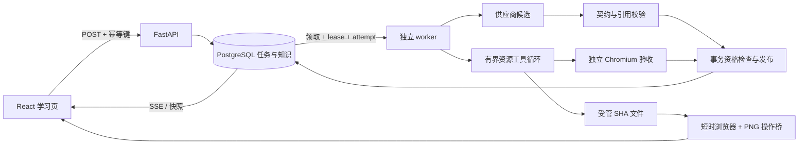

# 知脉：面试讲解与演示

本项目为本地单用户应用，没有真实用户规模或公开多用户部署。源码、冻结轨迹、检查与本地构建指纹一起交付；schema 合法、资源行为通过和教学事实准确分别表达。

## 三条可用的简历表述

- 使用 FastAPI、PostgreSQL 和独立 worker 实现持久生成任务：幂等身份与活动复用、lease/attempt、取消与版本资格、事务内发布/资源登记、SSE 游标恢复；以四个真实 SIGKILL 窗口与 20 次取消竞争验证有限一致性矩阵。[M3 证据](reports/m3-reliability-2026-10-07.md)
- 实现最多八步/八次调用/150 秒的资源制作 Agent，模型按真实工具反馈选择读取、修改和检查；受管文件、独立 Chromium 验收及应用提交资格共同控制发布。保留单次、固定修复和 Agent 的真实小样本对照与一次恢复后预算失败。[M5 证据](reports/m5-resource-agent-2026-10-07.md)
- 实现三种可切换上下文策略与依赖 SHA 绑定的正文摘录缓存；以 8 个保留场景、72 个公开合成规模单元进行同模型候选对照，记录 59 次调用、超预算退出、用量与费用，依据现有证据保留当前路径默认值。[M6 证据](reports/m6-context-2026-10-07.md)

可以描述自己实现了这些工程机制。不能写成真实用户并发、知识准确率、Agent 普遍胜出、外部调用严格一次或任意 JavaScript 完全安全。人工工时未逐段计时，保留未知。

## 架构讲解

模型调用与浏览器执行都在业务事务之外。线程/请求各使用独立同步 SQLAlchemy Session；当前没有 AsyncSession、Redis、向量库、微服务或多 Agent。数据库约束负责确定性身份与版本，语义同义/关系真实性仍需要其他证据。

## 三段演示脚本

先打开交付包中的离线 evidence-viewer.html。观看 recordings/jobs.webm、agent.webm、context.webm；视频都是**冻结记录回放**，没有新模型调用。录屏与查看器 SHA 在 recording.json 关联。

1. 持久任务：显示真实子进程在 response_saved 后 SIGKILL，attempt=1 到 attempt=2，后者复用确认保存的替身响应，正式 intake 只有一个；展示 20 次竞争各只有一个终态。进一步运行 tests/test_process_faults.py 复现当前实现，不能把视频称为新故障注入。
2. Agent：回放 M5 function_plot-1 的共享初始检查失败，错误为 missingSlope；随后真实模型选择 read_file、write_web、check_web、submit_candidate。显示固定 bootstrap 与模型决策来源，独立数字/图像检查通过后才交由应用发布。
3. 上下文：比较全历史、当前路径和结构选择；全历史 16 个规模单元在调用前退出。展示实际选入材料、三次修复、成本和局限，说明额外输入尚无经独立人审的收益证据。运行 tests/test_context_selection.py 查看设定/正文变化后的缓存失效。

新推理与回放分开：真实评测脚本必须使用新的输出目录和受控预算；普通展示不读 .env.local。完整应用默认 fake，问答后会自动登记首层大纲；再次访问复用保存结果。

## 追问与回答依据

| 追问 | 应说明的机制与限制 |
| --- | --- |
| 幂等与模型只调用一次是一回事吗？ | 幂等身份及最终事务资格约束正式发布；供应商已执行但未返回仍可能重复收费。未知用量保留预留。 |
| 为什么同时需要 lease 和 attempt？ | lease 决定时间资格，attempt/token 区分旧执行者；还有不可续长的单次截止，迟到结果不能覆盖恢复。 |
| 如何避免文件保存了但数据库未提交？ | 文件先按 SHA 原子保存；正式引用与成功状态在事务提交，未引用文件可识别。数据库与资源共同备份。 |
| Agent 哪一步是真的决策？ | 每步 origin 与模型调用、工具实测结果关联；固定初始检查与 scripted fixture 单列。检查规则由程序决定。 |
| 资源隔离证明了什么？ | 受控 Chromium、空来源、网络拒绝、无模型密钥、有限输入/操作与壁钟；没有硬内存配额或任意漏洞安全证明。源码编辑只生成临时工作副本。 |
| 为什么不用向量或 LangGraph？ | 当前问题由结构关系/关键词、显式持久步骤与事务可处理；M6 未给出质量收益依据。以后按问题和实验决定。 |
| 为什么仍保留当前路径？ | 同一保留集下，结构输入 token 多约 24%，质量代理未校准；当前数据支持保留更简单的默认策略。 |
| 是不是完成了课程/学习效果验证？ | 没有。内容显示未核验、问题版本可停用，选择题答对不等于掌握；六题独立人审尚未执行。 |
| 如何部署给多人？ | 当前仅回环单用户；认证、对象级授权、用户数据隔离和配额是后续范围。远程 CI 与发布没有运行。 |

最终数字与环境使用 [M7 报告](reports/m7-delivery-2026-10-07.md)，不把历史源版本的结果冒充最终代码测试。
